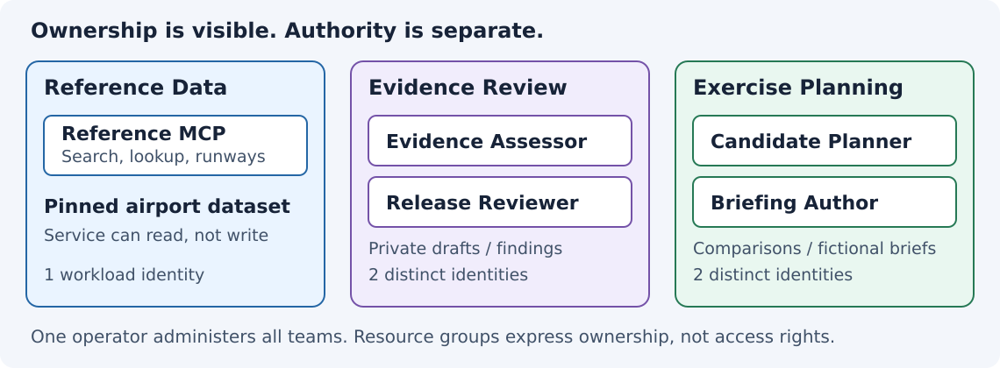
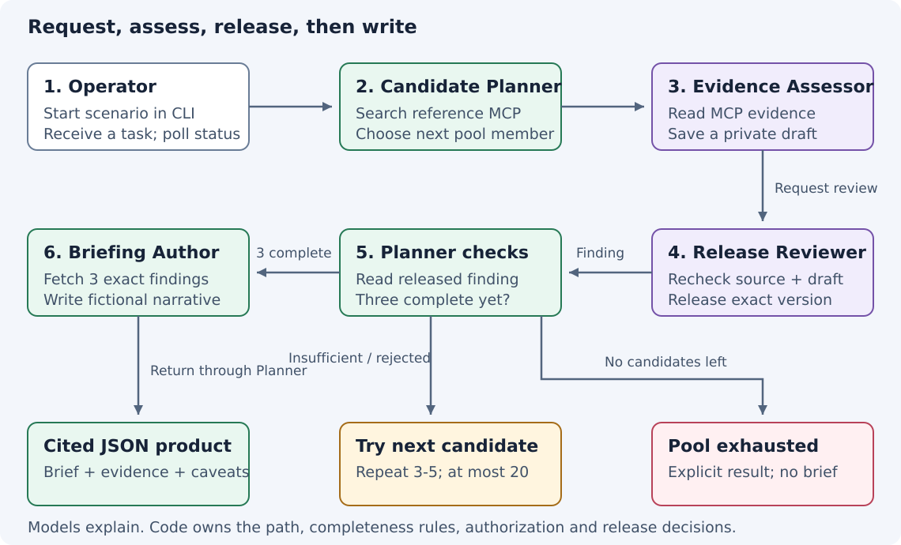
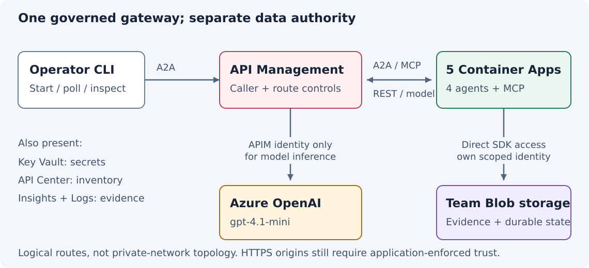
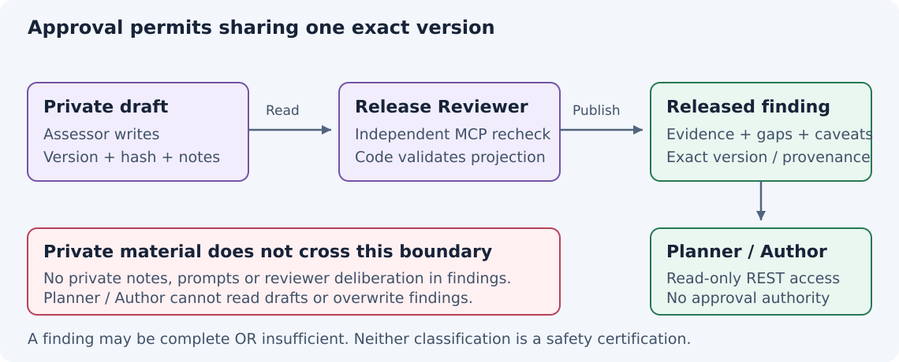

# Citadel sample

This project demonstrates cross-team agent permissions on Azure through a
fictional airport comparison. One team provides data, another assesses it and
approves findings for sharing, and a third uses those findings to write a brief.

The sample implements parts of the
[Citadel Blueprint](https://github.com/Azure-Samples/foundry-citadel-platform).
It runs from a terminal with four Python agents and a read-only data service.
Python code controls the workflow; the language model writes explanations and
the final brief.

The [OurAirports dataset](docs/evidence.md) supplies reference fields such as
runway width and surface. The exercise checks their completeness. Its results
must not be used for aviation decisions.

## The teams



Reference Data exposes read-only airport search, lookup and runway tools.
Evidence Review owns Evidence Assessor, which saves private drafts, and Release
Reviewer, which checks them before publishing findings. Exercise Planning owns
Candidate Planner and Briefing Author, which request assessments and write
comparisons from the published results.

Each application has its own managed identity, storage permissions and gateway
rules. The teams share one subscription and one human administrator.

## A comparison from start to finish

The operator starts a scenario through the CLI, which submits a task to Planner
and polls until it can retrieve the JSON result.



Planner searches at most 20 airports in the Netherlands, Belgium and Germany,
ordered by country and identifier. Assessor drafts an assessment for each
candidate and requests review. Planner then reads the released finding.

A finding with missing evidence can still be approved for sharing; Planner skips
that airport. With three complete candidates, Author reads their findings and
writes the brief. If the pool runs out, the result reports
`bounded_pool_exhausted` with no brief.

The JSON includes `selected_identifiers`, `assessed`, `provenance` and `caveats`.
A completed comparison also has a `brief` with exact finding citations.

There are four scenarios:

| Command argument | Exercise |
| --- | --- |
| `comparison` | Find three candidates with complete reference data and write a brief. |
| `replacement` | Remove a runway-width value through a labelled test overlay, then select another candidate. |
| `exhaustion` | Remove widths from every otherwise-complete candidate and return the exhausted-pool result. |
| `denied-bypass` | Attempt private-draft reads and finding overwrites with both planning identities, verify the denials, then run a comparison through the permitted route. |

Overlay changes are recorded with the results; the original dataset is unchanged.

## Components



The [Azure architecture overview](docs/architecture.md) shows every declared
service by resource group, with storage containers, identities and connections.

Microsoft Agent Framework and FastAPI run in four Azure Container Apps, each
with its own identity. A fifth app hosts Reference Data's MCP server.

Agents communicate over A2A, query data over MCP, and read findings over REST.
Azure API Management (APIM) routes these calls, authenticates individual
subscription credentials and enforces caller allowlists.

All model calls use APIM's identity to access one regional Azure OpenAI
`gpt-4.1-mini` deployment. Agents cannot call the model endpoint directly.

Team Blob storage holds data, work products and operation state. Workloads access
permitted containers directly using managed identities; Key Vault holds their
secrets. Application Insights and Log Analytics collect records for checking
application, gateway and storage activity.

API Center provides ownership and API inventory. Bicep defines the resources;
the operator CLI handles deployment, repair and removal.

## Private drafts and published findings



Assessor can write drafts but cannot publish findings. Only Reviewer can release
a particular draft version and hash, excluding private notes and deliberation.
Planner and Author can read findings but cannot read drafts or overwrite findings.

The release code enforces version immutability because the underlying Blob
Contributor permission allows overwrites. Application checks also enforce
operation ownership.

This covers resource-level permissions and application controls. Agent 365,
Entra Agent IDs, Conditional Access, Defender and Purview are outside the
implemented coverage.

## Implementation difficulties

SDK integration required different A2A routing and polling interfaces from those
in the examples, a Chat Completions adapter, and separate HTTPX/HTTPX2 clients. The
[stack notes](docs/stack.md#api-facts-that-differ-from-plausible-examples)
record the incompatibilities.

Gateway-to-app TLS failed with ingress certificate mode `require`. Using `accept`
allowed forwarding, while application middleware still required an authorized
certificate and signed caller context. That middleware protects the public
HTTPS origins against APIM bypass.

A timeout can occur after a draft or finding has been saved. Durable records,
Blob leases and explicit recovery track those partial results instead of blindly
retrying. Restarts do not resume unfinished tasks. This adds considerable
complexity to the sample.

Polling consumed the read budget: protocol and storage reads share a 512-read
limit within a 900-second run. Allocations and polling intervals were adjusted,
but final retrieval still failed in the recorded exhaustion run.

The selected API Center API cannot report its pricing plan. Deployment pauses
until the operator records portal verification of Free and explicitly continues.

## Current status

The [26 October handoff](https://github.com/JoranBergfeld/citadel-example/issues/21#issuecomment-6421372518)
records successful cloud comparison and replacement runs, origin rejections and
four storage-denial checks. Exhaustion saved a result that was recovered
separately after normal retrieval failed.

Combined denied-bypass acceptance remains incomplete. One run's evidence had an
invalid timestamp; another stopped during review with three drafts, two findings
and no brief. The latter failure remains unexplained.

Human review, remaining controls and two full acceptance passes are outstanding
in #21. These results describe previous runs.

## Running it

Follow [the operator guide](docs/operator.md) for the pinned toolchain, Azure
permissions, model quota and private deployment configuration. Deployment creates
paid resources, including five warm apps and APIM. They remain billable until
removed; there is no spending cap or automatic cleanup.

With a deployed instance and `CITADEL_STATE_DIR` pointing to its private state:

```sh
python -m citadel.operator demo comparison \
  --state-dir "$CITADEL_STATE_DIR" --run-id compare001

python -m citadel.operator status \
  --state-dir "$CITADEL_STATE_DIR" --run-id compare001
```

Run sequentially with a new ID for each run. Reusing an ID checks existing work;
unfinished runs may need reconciliation. Denied-bypass and acceptance tests can
temporarily change workload configuration; avoid them during presentations.

For further detail, see [data and fixtures](docs/evidence.md),
[runtime behavior](docs/runtime.md), [infrastructure](docs/infrastructure.md),
[operation recovery](docs/operations.md), and
[acceptance checks](docs/acceptance.md). The
[original specification](https://github.com/JoranBergfeld/citadel-example/issues/13)
records the intended scope.

## Offline unit tests

In the installed project environment, from the repository root:

```sh
python -m unittest discover -s tests/unit -v
python -m unittest discover -s tests/unit -p 'test_candidate_planner.py' -v
```

See [testing commands and boundaries](docs/testing.md) for other focused areas,
fixtures, migration scope and claim limits. These tests need no cloud resources,
credentials, real model, Docker or external network; passing them does not prove
deployed enforcement or real-demo success.
