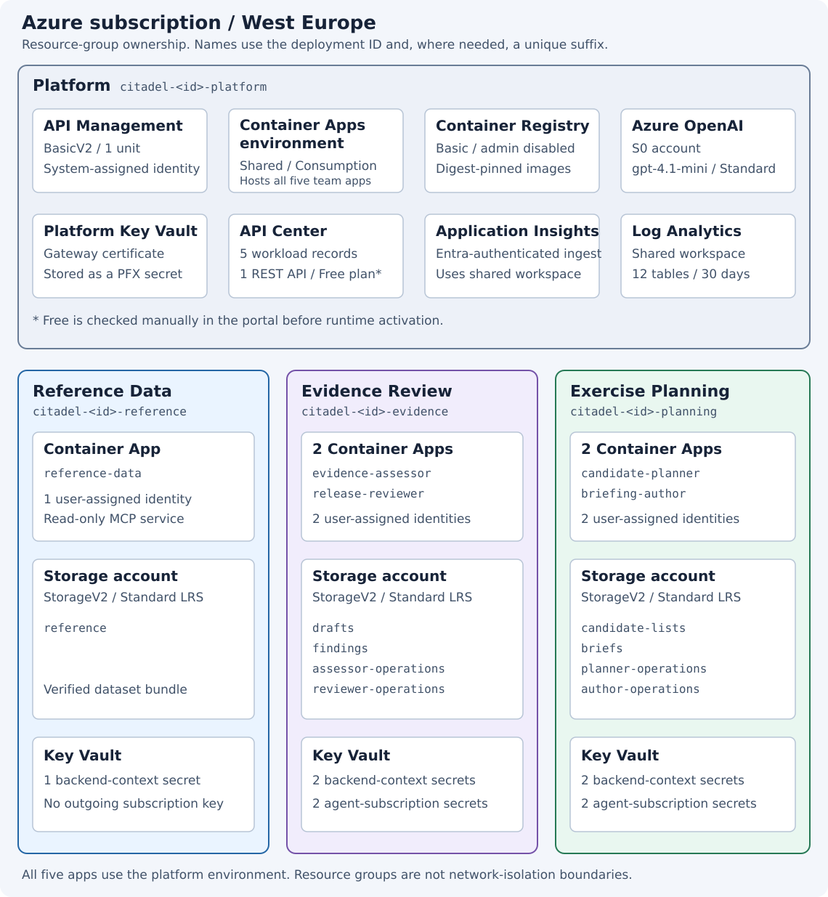

# Azure architecture

The sample uses one Azure subscription in West Europe. Four resource groups
separate the shared platform from the three teams. This overview follows
[`infra/main.bicep`](../infra/main.bicep) and its modules, rather than querying a
live deployment.

## Resource layout

The five Container Apps belong to their teams' resource groups, but all use the
same Container Apps managed environment in the platform group. Each app has
0.5 vCPU, 1 GiB memory and one configured replica. Rolling revisions can briefly
overlap.

There is one Basic Container Registry for digest-pinned images, one BasicV2
APIM instance, and one Azure OpenAI account. Its regional Standard deployment is
`gpt-4.1-mini`, version `2025-04-14`, with automatic upgrades disabled.

The [interactive group overview](architecture.html) summarizes the same services.
Its editable source is [architecture.json](architecture.json).

## Connections

The operator calls Planner through APIM. Agents use their own APIM subscription
credentials for subsequent A2A, MCP and REST requests. APIM forwards requests to
the public Container App origins with a client certificate and signed caller
context; application middleware validates both.

All model calls also pass through APIM. APIM's system-assigned identity has
OpenAI inference permission; the five workload identities do not.

Each app pulls images from ACR and reads its allocated Key Vault secrets using
its own user-assigned identity. Direct Blob access uses that identity too.
Storage and Key Vault calls are not proxied through APIM.

Application telemetry and APIM's Application Insights logger feed the shared
Application Insights component, which uses the Log Analytics workspace.
Diagnostic settings send Container Apps environment logs, APIM gateway logs,
Blob read/write/delete logs and all four vaults' audit logs to that workspace.
The templates configure 12 Analytics tables with 30-day retention. Workloads
can ingest telemetry but cannot query the workspace; designated collectors can.

API Center has no role in the request path. The deployment CLI records workload
and REST metadata there.

## Identities and storage

There are five user-assigned managed identities, one per application, plus APIM's
system-assigned identity. Blob grants are scoped to individual containers:

| Workload identity | Blob access |
| --- | --- |
| `reference-data` | Read `reference`. |
| `evidence-assessor` | Contribute to `drafts` and `assessor-operations`. |
| `release-reviewer` | Read `drafts`; contribute to `findings` and `reviewer-operations`. |
| `candidate-planner` | Contribute to `candidate-lists` and `planner-operations`. |
| `briefing-author` | Contribute to `briefs` and `author-operations`. |

Planner and Author read findings through the Reviewer's REST endpoint, not
through Evidence Review's storage account. Normal runtime writes store
comparison and brief products in the operation ledgers; the separately allocated
`candidate-lists` and `briefs` containers are not their normal output path.
Blob Contributor permits overwrites and deletes, so application code enforces
published-version immutability.

## Child resources

APIM contains five workload APIs and one model API, their operations and policies,
six backends, five caller subscriptions, five secret context named values, and
the gateway client-certificate reference. It also has an Application Insights
logger and diagnostic configuration.

API Center contains a `default` workspace, seven metadata schemas, five workload
environment records, and one released-findings REST API with a version,
definition and deployment record. These are inventory entries, not additional
Container Apps environments or native A2A/MCP registrations.

The three storage accounts contain nine Blob containers, shown in the diagram.
Shared-key authentication and anonymous Blob access are disabled. They use
Standard LRS storage; Blob versioning and soft-delete are disabled.

The four Key Vaults use RBAC and seven-day soft-delete. The platform vault holds
the gateway certificate as a PFX secret. Team vaults hold five backend-context
secrets and four agent-subscription secrets in total. Workloads can read only
their allocated secrets; only APIM can read the platform certificate secret.
Role assignments and diagnostic settings accompany the services above.

## Network and deployment scope

The templates declare public service endpoints, not a customer VNet, NSGs or
private endpoints. HTTPS, certificate/context validation and Azure permissions
enforce access; resource-group placement does not isolate network traffic.

Azure can create additional service-managed infrastructure, deployment records,
Container Apps revisions and an Application Insights failure-anomaly alert.
The operator's live inventory must account for these. External Event Grid
resources are not created or owned by this sample.

Foundation deployment creates shared and team resources first. Runtime activation
adds the five apps, gateway APIs and capability inventory after data preparation,
image publication and the human API Center plan check.

Source: [platform](../infra/modules/platform.bicep),
[teams and storage grants](../infra/modules/team.bicep),
[apps](../infra/modules/app.bicep),
[gateway](../infra/modules/gateway.bicep), and
[API Center inventory](../infra/modules/inventory.bicep).
